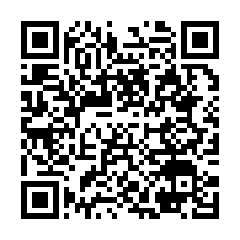

# Overdoing BTC Warm Wallet v2

[中文](#中文) | [English](#english)

> 設計沿用 overdoingism 的 [Overdoing ETH Warm Wallet](https://github.com/overdoingism/Overdoing-ETH-Warm-Wallet-V2) ｜ 程式碼由 Claude AI（Anthropic）撰寫。
> Follows the design of overdoingism's Overdoing ETH Warm Wallet. Code written by Claude AI (Anthropic).

## 線上使用 / Use it online

<a href="https://overdoingism.github.io/Overdoing-BTC-Warm-Wallet-V2/dist/oebw.html"></a>

用手機掃描，或直接開啟 / Scan with your phone, or open:
**<https://overdoingism.github.io/Overdoing-BTC-Warm-Wallet-V2/dist/oebw.html>**

> 這是由 GitHub Pages 提供的 `dist/oebw.html`，內容隨 `main` 分支更新。存放較多資金時，建議下載檔案並核對 `dist/SHA256SUMS`。
> This is `dist/oebw.html` served by GitHub Pages and follows the `main` branch. For larger amounts, download the file and check it against `dist/SHA256SUMS`.

---

## 中文

一個**單一 HTML 檔案**的比特幣（BTC）與比特幣現金（BCH）錢包，可以連線使用，也可以利用 QR 碼在**完全不連網（air-gap）**的裝置上簽名。

只需要 `dist/oebw.html` 這一個檔案：所有程式與函式庫都已內嵌，不會載入任何外部資源；開啟後在你按下「同步」或「廣播」之前，不會發出任何網路請求。

### 功能

- **Bitcoin 四種地址**：Native SegWit（`bc1q…`，BIP84）、Taproot（`bc1p…`，BIP86）、Nested SegWit（`3…`，BIP49）、Legacy（`1…`，BIP44）。
- **Bitcoin Cash**：CashAddr 地址（也接受舊式地址並自動轉換）；含 CashToken 的 UTXO 會自動排除，避免代幣被銷毀。
- **BIP39 助記詞**（12–24 字、BIP39 密語、帳戶編號或自訂路徑）、**WIF 私鑰**；觀察模式可使用 **xpub / ypub / zpub、輸出描述子**或單一地址。
- **PSBT（BIP174）＋ BC-UR 動態 QR**：與 Sparrow、Keystone、BlueWallet、Nunchuk 等支援 `crypto-psbt` 的錢包互通；帳戶可用 `crypto-account` QR 或描述子匯出。
- **手動選擇 UTXO**（coin control）、「全部」金額、自訂手續費率（可輸入小數）。
- **RBF 加速**（僅 BTC）：在「最近交易」對未確認的付款按「加速」，以更高手續費取代原交易。
- **簽署／驗證訊息**：一般地址使用 BIP137（Electrum 格式），Taproot 使用 BIP322。
- **加密儲存助記詞於瀏覽器**（選用，scrypt + AES-256-GCM）。儲存前會清楚說明風險並需勾選同意；BIP39 密語不會被儲存。
- **相機掃描 QR**（也可從圖片讀取或貼上文字），中英文介面，深色模式，手機版面。
- 網路：Bitcoin 主網、Testnet4、Signet、Regtest；Bitcoin Cash 主網、Chipnet、Testnet4、Regtest。可自訂伺服器（Esplora `https://` 或 Electrum／Fulcrum `wss://`）。

### UTXO 怎麼處理

比特幣沒有「帳戶餘額」，只有一筆筆未花費的輸出（UTXO）。按「同步」時錢包會：

1. 依 BIP44 規則掃描收款與找零兩條地址鏈，直到連續 20 個未使用的地址（gap limit 20）；
2. 列出這些地址上所有的 UTXO，加總為餘額；
3. 發送時自動挑選 UTXO，找零送到下一個未使用的找零地址。也可以在「手動選擇 UTXO」中自己勾選。

離線簽名裝置不需要同步：它只從待簽交易（PSBT）中讀取輸入資料，並自行重新推導金鑰，確認哪些輸入與找零真的屬於自己。

### 三種用法

在「帳戶」貼上什麼，就決定了這台裝置的角色：

| 輸入 | 模式 | 可以做什麼 |
| --- | --- | --- |
| 助記詞或 WIF 私鑰 | **可簽名** | 簽名；連網時也可直接同步與廣播（熱錢包） |
| xpub／描述子／地址 | **僅觀察** | 同步餘額、建立待簽 QR、廣播已簽名的交易 |

#### 離線簽名（air-gap）流程

1. **離線裝置**：載入助記詞 →「匯出帳戶」，顯示 `crypto-account` QR。
2. **連網裝置**：按「掃描」讀取 → 成為觀察帳戶 →「同步」→ 填寫收款地址與數量 →「建立待簽 QR」。
3. **離線裝置**：按「掃描」讀取（動態 QR 會自動收集所有片段）→ 確認內容 →「確認簽名」→ 顯示已簽名的 QR。
4. **連網裝置**：按「掃描」讀取 →「廣播」。

離線裝置可以換成任何支援 PSBT 的硬體或軟體錢包，反之亦然。訊息簽名也是同樣的流程（在「進階」）。

> **相機的限制**：瀏覽器只在安全環境開放相機。電腦上的 Chrome / Edge 以 `file://` 開啟即可使用；iPhone 的 Safari 必須以 `https://`（例如 GitHub Pages）開啟。無法使用相機時，可改用「從圖片讀取」或貼上 QR 的文字內容。

### 安全設計

- 單一檔案，並以 **Content-Security-Policy** 鎖定：只允許內嵌的那一段程式（以雜湊值驗證）執行，不能載入外部程式碼。
- 簽名前一定會顯示「最終檢查」：網路、付款對象與金額、找零（標示已驗證為自己的地址與路徑）、輸入總額、手續費與費率、RBF，以及各種警告。
- **防止手續費詐騙**：非 Taproot 的輸入必須附上完整的前一筆交易，且其交易 ID 必須相符，否則拒絕簽名（被竄改的 PSBT 會被偵測出來）；Taproot 的簽章涵蓋所有輸入金額，BCH 的簽章涵蓋所簽輸入的金額，謊報金額只會得到無效的簽章。
- **找零驗證**：找零地址會以自己的金鑰重新推導並比對，不會只相信 PSBT 的標示。
- 不屬於此帳戶的輸入不會被簽署；多方交易會清楚標示。
- ECDSA 採用 RFC 6979 決定性簽章，不依賴離線裝置亂數產生器的品質。

### 相容性備註

- BCH 沒有被廣泛採用的 PSBT 標準。本錢包沿用 PSBT 格式（以 `bch-psbt` UR 類型傳遞），因此 BCH 的離線簽名需兩端都使用本錢包；BCH 單純收付與熱錢包不受影響。
- 只支援單一金鑰帳戶（不支援多簽）；不支援「未壓縮」格式的舊式私鑰。
- 若你在其他錢包中跳過了超過 20 個未使用的地址，那之後的資金不會被掃描到。

### 從原始碼建置與測試

需要 Node.js 20 以上。

```bash
npm install
npm run build              # 產生 dist/oebw.html 與 dist/SHA256SUMS（建置結果可重現）
npm test                   # 單元測試：BIP 規範向量，並與 bitcoinjs-lib、libauth、@ngraveio/bc-ur 交叉比對
npm run test:integration   # 本機 regtest 節點整合測試
npm run test:e2e           # 端對端測試：regtest 節點 + 瀏覽器（使用已安裝的 Edge）
```

整合與端對端測試需要 Bitcoin Core、Bitcoin Cash Node 與 Fulcrum 的執行檔，放在 `%LOCALAPPDATA%\overdoing-regtest`（或以環境變數 `OEBW_REGTEST_TOOLS` 指定）。它們只用於測試，不會被包進錢包檔案。`OEBW_PUBLIC=1 npx playwright test public-servers` 會檢查內建的公開伺服器（需連網，唯讀）。

原始碼在 `src/`：`core/` 是不依賴瀏覽器的錢包邏輯（金鑰、地址、PSBT、BCH 簽章、UR、伺服器），`ui/` 與 `main.js` 是介面。BC-UR 依 BCR-2020-005／006 規範自行實作，並在測試中與 @ngraveio/bc-ur 逐片段比對，以避免把它的 Node.js 相依套件包進錢包。

### 授權

MIT，見 [LICENSE](LICENSE)。內嵌的函式庫（@scure/btc-signer、@scure/bip32、@scure/bip39、@scure/base、@noble/\*、micro-packed、qr）都以 MIT 授權使用（qr 為 MIT／Apache-2.0 雙授權），聲明列於 `dist/oebw.html` 檔頭。

作者對本程式不負任何責任，請先以測試網或小額測試。

---

## English

A Bitcoin (BTC) and Bitcoin Cash (BCH) wallet in a **single HTML file**. Use it online, or sign on a device that is **never online (air-gapped)**, passing data by QR code.

`dist/oebw.html` is all you need: every library is inlined, nothing external is loaded, and the page makes no network request until you press "Sync" or "Broadcast".

### Features

- **All four Bitcoin address types**: Native SegWit (`bc1q…`, BIP84), Taproot (`bc1p…`, BIP86), Nested SegWit (`3…`, BIP49), Legacy (`1…`, BIP44).
- **Bitcoin Cash** with CashAddr (legacy addresses are accepted and converted). UTXOs carrying CashTokens are excluded so tokens are never burned.
- **BIP39 mnemonics** (12–24 words, passphrase, account number or custom path) and **WIF keys**; watch-only from **xpub / ypub / zpub, output descriptors** or a single address.
- **PSBT (BIP174) + BC-UR animated QR codes**, interoperable with Sparrow, Keystone, BlueWallet, Nunchuk and other `crypto-psbt` wallets. Accounts export as a `crypto-account` QR or a descriptor.
- **Coin control**, "Max", and fractional fee rates.
- **RBF fee bumping** (BTC): "Speed up" an unconfirmed payment from the recent-transactions list.
- **Sign / verify messages**: BIP137 (Electrum format) for regular addresses, BIP322 for Taproot.
- **Optional encrypted mnemonic storage** in the browser (scrypt + AES-256-GCM), with an explicit risk warning that must be acknowledged; the BIP39 passphrase is never stored.
- **Camera QR scanning** (or read from an image, or paste), Chinese / English UI, dark mode, phone layout.
- Networks: Bitcoin mainnet, Testnet4, Signet, Regtest; Bitcoin Cash mainnet, Chipnet, Testnet4, Regtest. Custom servers: Esplora (`https://`) or Electrum / Fulcrum (`wss://`).

### How UTXOs are handled

"Sync" scans the receive and change chains until 20 unused addresses in a row (BIP44 gap limit), lists the unspent outputs of the used ones and adds them up. Sending picks UTXOs automatically (or the ones you tick) and sends change to the next unused change address. The offline signer never syncs: it reads everything it needs from the PSBT and re-derives its own keys to recognise its inputs and change.

### Air-gapped flow

1. Offline device: load the mnemonic → "Export account" (a `crypto-account` QR).
2. Online device: "Scan" it (watch-only) → "Sync" → recipient and amount → "Create sign request".
3. Offline device: "Scan" (animated QR parts are collected automatically) → review → "Sign".
4. Online device: "Scan" the signed QR → "Broadcast".

Either side can be replaced by any PSBT-capable hardware or software wallet. Message signing works the same way (under "Advanced").

> **Camera note**: Chrome / Edge on a computer allow the camera for `file://`; Safari on iPhone needs `https://`. Without a camera, use "Read from image" or paste the QR text.

### Security

- One file, locked down by a **Content-Security-Policy** that only lets the inlined script (pinned by hash) run.
- Every signature is preceded by a full review (recipients, change verified as yours with its path, input total, fee and fee rate, RBF) with warnings.
- **Fee attacks are blocked**: non-Taproot inputs must carry their full previous transaction with a matching txid, otherwise signing is refused; Taproot signatures commit to every input amount and BCH signatures to the signed input's amount, so a misreported amount only yields an invalid signature.
- **Change is verified** by re-deriving the key, never trusted from PSBT metadata. Inputs that are not yours are never signed.
- ECDSA signatures are deterministic (RFC 6979).

### Compatibility notes

- There is no widely adopted PSBT standard for BCH. This wallet reuses the PSBT container (UR type `bch-psbt`), so air-gapped BCH signing needs this wallet on both sides. Hot-wallet use is unaffected.
- Single-key accounts only (no multisig); uncompressed legacy private keys are not supported.
- Funds beyond a gap of more than 20 unused addresses are not discovered.

### Build and test

Node.js 20+:

```bash
npm install
npm run build              # writes dist/oebw.html and dist/SHA256SUMS (reproducible)
npm test                   # unit tests: BIP vectors, cross-checked with bitcoinjs-lib, libauth and @ngraveio/bc-ur
npm run test:integration   # against local regtest nodes
npm run test:e2e           # end-to-end: regtest nodes + browser (installed Edge)
```

Integration and end-to-end tests need Bitcoin Core, Bitcoin Cash Node and Fulcrum binaries in `%LOCALAPPDATA%\overdoing-regtest` (or `OEBW_REGTEST_TOOLS`); they are test tools only and are not part of the wallet file. `OEBW_PUBLIC=1 npx playwright test public-servers` checks the built-in public servers (read-only, needs internet).

BC-UR is implemented from BCR-2020-005 / 006 and checked part-for-part against @ngraveio/bc-ur in the tests, which keeps that library's Node.js dependencies out of the wallet.

### License

MIT, see [LICENSE](LICENSE). The bundled libraries (@scure/btc-signer, @scure/bip32, @scure/bip39, @scure/base, @noble/\*, micro-packed, qr) are used under the MIT license (qr is dual MIT / Apache-2.0); their notices are in the header of `dist/oebw.html`. No warranty — try a testnet or a small amount first.
